<div align="center">


# Mì Quảng Bách Khoa

**Game quản lý quán mì Quảng trên web, viết cho sinh viên Đại học Bách Khoa Đà Nẵng.**
Bán mì cho sinh viên các khoa, giữ uy tín quán, rồi đua điểm theo cá nhân, theo lớp và theo khoa.

[**▶ Chơi ngay**](https://miquangbk.com/) · chạy trên điện thoại và laptop, cài được như ứng dụng (PWA)

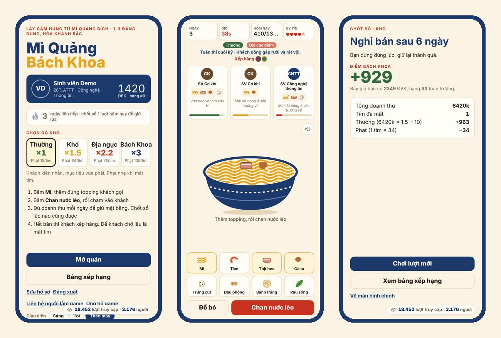

</div>

> **In English.** *Mì Quảng Bách Khoa* is a browser-based restaurant time-management game built for students of the University of Science and Technology, University of Da Nang. Players assemble bowls of mì Quảng (a central-Vietnamese noodle dish) against customer patience timers, upgrade their shop between days, and compete on student, class and faculty leaderboards, or challenge each other to real-time 1v1 matches rated with Elo. It is a single-file HTML/CSS/vanilla JS app (no build step, no framework) backed by Supabase (Postgres + Auth + Storage), with server-side score validation via `SECURITY DEFINER` RPCs and row-level security, offline-safe score submission, Duolingo-style daily streaks, and sound effects synthesised entirely with the Web Audio API. The concept, setting and product decisions are mine; the code was written by Claude (Anthropic's AI assistant) working from my ideas and direction — see section 11 for who did what.

---

## Mục lục

1. [Ý tưởng](#1-ý-tưởng)
2. [Cách chơi](#2-cách-chơi)
3. [Độ khó và cách tính điểm](#3-độ-khó-và-cách-tính-điểm)
4. [Nâng cấp quán](#4-nâng-cấp-quán)
5. [Tài khoản, bảng xếp hạng và streak](#5-tài-khoản-bảng-xếp-hạng-và-streak)
   - [Solo: thách đấu bạn bè](#solo-thách-đấu-bạn-bè)
6. [Giao diện và trải nghiệm](#6-giao-diện-và-trải-nghiệm)
7. [Kiến trúc kỹ thuật](#7-kiến-trúc-kỹ-thuật)
8. [Những bài toán kỹ thuật đáng chú ý](#8-những-bài-toán-kỹ-thuật-đáng-chú-ý)
9. [Cấu trúc thư mục](#9-cấu-trúc-thư-mục)
10. [Chạy thử trên máy](#10-chạy-thử-trên-máy)
11. [Cách mình làm dự án này](#11-cách-mình-làm-dự-án-này)
12. [Tác giả](#12-tác-giả)

---

## 1. Ý tưởng

Ý tưởng ban đầu đến khá tự phát: mình muốn có một game **đậm chất Bách Khoa Đà Nẵng**, giống cách sinh viên HUST có "Bánh mì Bách Khoa". Món được chọn là mì Quảng, đặc sản của miền Trung. Bối cảnh phải là một quán có thật, nơi sinh viên trường mình hay ăn.

Game lấy cảm hứng từ **Mì Quảng Bích** (1-3 Đặng Dung, Hòa Khánh Bắc, Liên Chiểu), một quán quen của sinh viên Bách Khoa. Người chơi là chủ quán. Khách là sinh viên của 9 khoa: CNTT, Cơ khí, Điện, Xây dựng, Hóa, Điện tử viễn thông, Kiến trúc, Môi trường và Cơ khí giao thông. Câu thoại của khách lấy từ đời sống sinh viên, ví dụ "Chiều thi Giải tích 2, ăn cho tỉnh!" hay "Code xuyên đêm, đói quá chú ơi".

Mục tiêu của dự án:

- Một game **chơi nhanh**, mỗi ngày trong game chỉ 75 giây, hợp với giờ nghỉ giữa tiết.
- **Tạo tinh thần thi đua** giữa các lớp và các khoa, nhờ bảng xếp hạng chung toàn trường.
- **Kéo người chơi quay lại mỗi ngày** bằng chuỗi ngày liên tiếp (streak) kiểu Duolingo.

## 2. Cách chơi

<p align="center">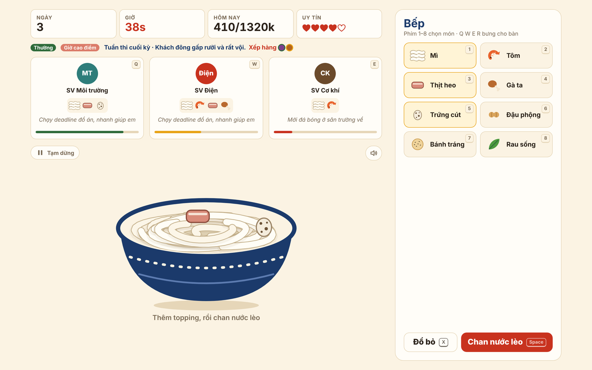</p>

### Vòng lặp một ngày bán

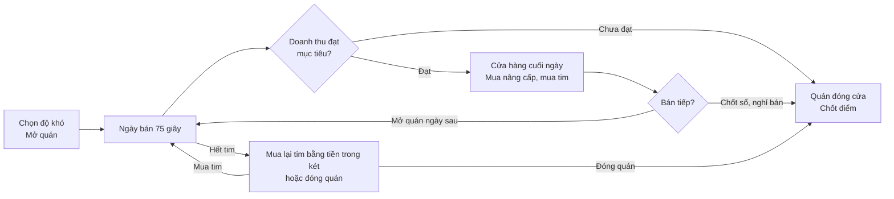

### Thao tác làm một tô mì

1. Bấm **Mì** để cho vắt mì vào tô. Sợi mì Quảng vẽ đúng kiểu thật: dẹt, to bản, màu trắng ngà, cuộn thành ổ trong tô; chan nước lèo thì nước chỉ xâm xấp ở đáy như mì Quảng thật.
2. Thêm **đúng các topping** khách gọi. Có 7 loại: tôm, thịt heo, gà ta, trứng cút, đậu phộng, bánh tráng, rau sống.
3. Bấm **Chan nước lèo**.
4. Bấm vào khách để bưng ra. Nếu làm sai, bấm **Đổ bỏ** để làm lại.

| Phím (laptop) | Tác dụng |
|---|---|
| `1` – `8` | Chọn nguyên liệu (Mì, Tôm, Thịt heo, Gà ta, Trứng cút, Đậu phộng, Bánh tráng, Rau sống) |
| `Space` | Chan nước lèo |
| `Q` `W` `E` `R` | Bưng cho bàn 1, 2, 3, 4 |
| `X` hoặc `Backspace` | Đổ bỏ tô đang làm |

### Khách, thời gian và uy tín

- Mỗi khách có **thanh kiên nhẫn**, màu chuyển xanh → vàng → đỏ. Hết bàn thì khách phải **xếp hàng**, và hàng chờ cũng có giới hạn kiên nhẫn riêng.
- Bưng sai món, hoặc để khách chờ quá lâu, quán **mất 1 tim uy tín**. Quán có tối đa 5 tim.
- Khách được phục vụ nhanh sẽ **tip nhiều hơn**. Thỉnh thoảng có **thầy ghé ăn**: trả giá gấp đôi nhưng vội hơn sinh viên.
- **Giờ cao điểm**: khi đồng hồ còn từ 45 đến 25 giây, khách đến nhanh gấp đôi.
- Bốn kiểu ngày xoay vòng, mỗi kiểu đổi nhịp khách và tiền tip:

| Kiểu ngày | Đặc điểm |
|---|---|
| Ngày thường | Khách đến đều đều |
| Giờ tan học | Khách đông hơn một chút |
| Tuần thi cuối kỳ | Khách đông gấp rưỡi và rất vội |
| Mưa bão miền Trung | Ít khách, nhưng ai ghé cũng tip gấp đôi |

- Mỗi ngày có **mục tiêu doanh thu** (tiền mặt bằng). Không đạt mục tiêu thì quán đóng cửa và lượt chơi kết thúc. Mục tiêu được hiệu chỉnh từ **mô phỏng 2.000 ván** của một người chơi khá, rồi tăng dần qua từng ngày.
- **Hết tim giữa ngày** thì game tạm dừng. Người chơi có thể bỏ 500k trong két ra mua lại 1 tim để bán tiếp, hoặc đóng quán và chốt điểm.

## 3. Độ khó và cách tính điểm

Trước mỗi lượt, người chơi chọn một trong 4 mức. Mức càng cao thì khách càng vội, tô càng nhiều topping, mục tiêu càng cao, đổi lại điểm thưởng được nhân lớn hơn.

| Độ khó | Hệ số thưởng | Phạt mỗi tim mất | Mất cả 5 tim |
|---|---|---|---|
| Thường | ×1 | −15 | −75 |
| Khó | ×1.5 | −34 | −169 |
| Địa ngục | ×2.2 | −73 | −363 |
| Bách Khoa | ×3 | −135 | −675 |

**Điểm Bách Khoa (ĐBK)** của một lượt:

```
ĐBK = tổng doanh thu × hệ số ÷ 10  −  số tim đã mất × 15 × hệ số²
```

Mua lại tim **không xoá điểm phạt**. Tiền mua tim và mua nâng cấp lấy từ két, không làm giảm doanh thu tính điểm. Bỏ dở lượt giữa chừng thì tính như mất cả 5 tim.

Vì vậy, quyết định **chốt sổ lúc nào** là một phần chiến thuật: bán thêm ngày thì có thêm doanh thu, nhưng mục tiêu tăng lên và rủi ro mất tim cũng lớn hơn.

<p align="center">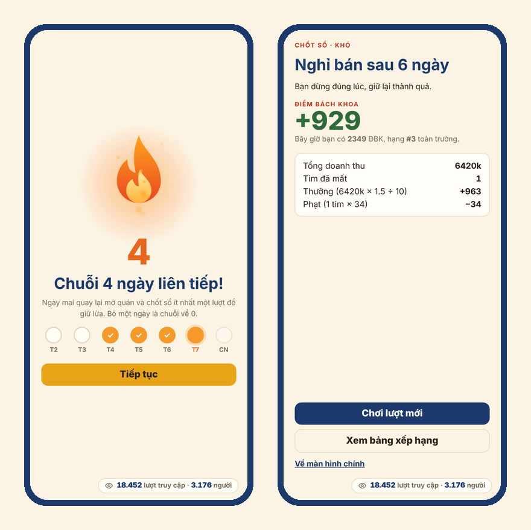</p>

## 4. Nâng cấp quán

Cuối mỗi ngày, người chơi dùng tiền trong két để mua nâng cấp. Có **14 dòng nâng cấp**, một số dòng có nhiều cấp:

| Nâng cấp | Tác dụng | Giá |
|---|---|---|
| Quạt máy → Quạt hơi nước → Máy lạnh | Khách chờ lâu hơn 15% / 30% / 45% | 150k / 300k / 550k |
| Phụ bếp | Tô nào cũng có sẵn vắt mì | 250k |
| Nồi nước lèo 50 lít | Tự chan nước lèo khi bưng ra | 350k |
| Rổ rau sống trên bàn | Khách tự lấy rau, không cần cho rau vào tô | 200k |
| Bảng hiệu Bách Khoa → Bảng đèn LED | Giá +10% / +20%, khách đến nhanh hơn | 200k / 450k |
| Wifi miễn phí | Sinh viên ngồi lâu, tip nhiều hơn 50% | 300k |
| Thêm bàn thứ 4 | Phục vụ 4 khách cùng lúc | 400k |
| Thẻ tích điểm sinh viên | Mỗi ngày giữ chân 1 khách sắp bỏ về | 500k |
| Ghế chờ có mái che → Trà đá miễn phí | Hàng chờ dài hơn, khách xếp hàng kiên nhẫn hơn | 300k / 550k |
| Fanpage quán → Video TikTok viral | Khách đến nhanh hơn 10% / 20%, thêm tip | 250k / 600k |
| TV chiếu LMHT, Valorant | Giờ cao điểm khách kiên nhẫn hơn 30% | 300k |
| Thực đơn combo sinh viên | Một nửa số khách gọi bớt 1 món | 350k |
| Thanh toán QR | Khách trả nhanh, mỗi tô thêm 3k | 200k |
| Nhân viên chạy bàn | Tô vừa chan xong tự bưng tới khách gọi đúng món | 700k |

<p align="center">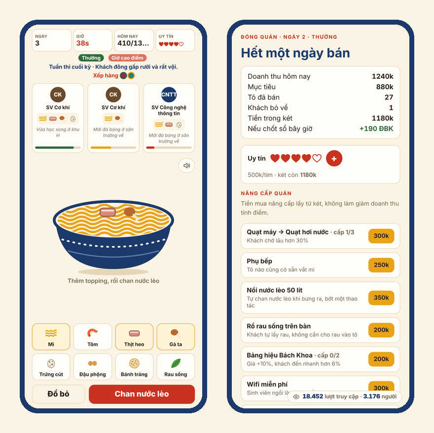</p>

## 5. Tài khoản, bảng xếp hạng và streak

<p align="center">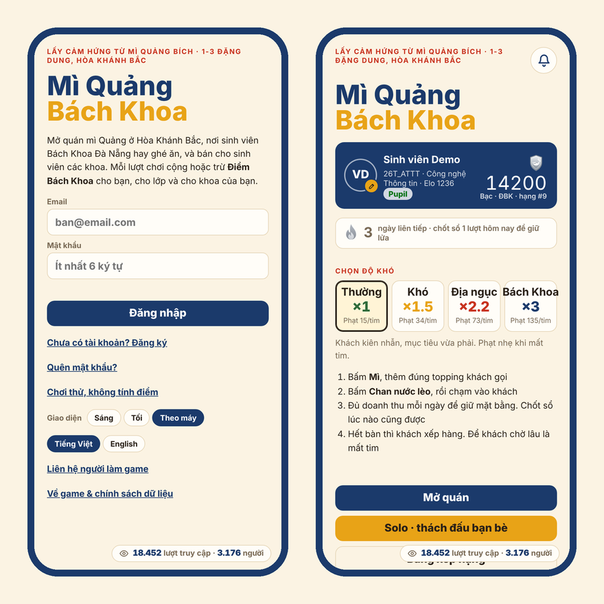</p>

- **Mở trang là chơi được ngay**, không bắt đăng nhập trước (bản 2.21.0). Lượt chơi thử có lời được giữ trên máy 24 giờ: tạo tài khoản trong thời gian đó thì server tính lượt này (hàm `nhan_luot_thu`, chỉ một lần cho tài khoản chưa có lượt nào, cùng luật chống gian lận như nộp điểm thường).
- **Người mới được dẫn tay**: ngày đầu của 2 lượt đầu tiên là "ngày khai trương": khách kiên nhẫn gấp rưỡi, gọi tối đa 2 topping, đến thưa hơn. 3 tô đầu có chỉ tay từng bước (nút cần bấm sáng lên, có chữ hướng dẫn). Ba mức khó hơn bị khoá mềm: bấm lần đầu chỉ hiện cảnh báo mức phạt, bấm lần nữa mới chọn. Lý do: số liệu cho thấy 58% lượt chơi chết ngay ngày 1, nhiều người mới chọn luôn mức Bách Khoa rồi mất hết tim.
- **Đăng ký bằng email**, có xác nhận email và đặt lại mật khẩu. Email gửi qua Resend với mẫu HTML riêng.
- **Hồ sơ**: tên, câu hỏi **"Bạn là ai, học hoặc dạy ở đâu?"** (sinh viên BK Đà Nẵng / sinh viên trường khác / **giáo viên** / không đi học), khoa và lớp (bắt buộc với sinh viên BKĐN), trường (76 trường đại học, cao đẳng trên cả nước, chọn trong danh sách), và **ảnh đại diện** có công cụ cắt và phóng to ngay trong game. Người không phải sinh viên BKĐN vẫn chơi, tính ĐBK và solo như mọi người, tên kèm nhãn trường của họ (hoặc **Ngoài BK** nếu không đi học), được tính vào bảng Trường nhưng không vào bảng lớp và khoa.
- **Bảng xếp hạng bốn cấp**:
  - *Cá nhân*: tổng ĐBK của từng người. Có bộ lọc **Tất cả người chơi** / **Chỉ sinh viên BK** (hạng được tính lại trong nhóm đang xem); tab Solo cũng lọc được như vậy.
  - *Trường* (bản 2.21.0): tổng ĐBK của 30 người cao nhất trường, chia 30. Mọi trường đều đua được, BK Đà Nẵng tính cả sinh viên đã chơi từ trước.
  - **Giáo viên** (bản 2.22.0): thầy cô chọn trường mình dạy (kể cả BKĐN), tên có nhãn **GV**, điểm tính vào bảng Trường cùng sinh viên trường đó. Bảng Cá nhân và Solo có thêm bộ lọc **Giáo viên** và **Trường mình** để xem thầy cô đua với sinh viên cùng trường.
  - *Lớp*: tổng ĐBK của 10 bạn cao nhất lớp, chia 10.
  - *Khoa*: tổng ĐBK của 30 bạn cao nhất khoa, chia 30.

  Cách tính này giúp lớp ít người vẫn cạnh tranh được, và một cá nhân "cày" nhiều không kéo cả lớp lên một mình. Bảng lớp và khoa chỉ tính sinh viên Bách Khoa.

<p align="center">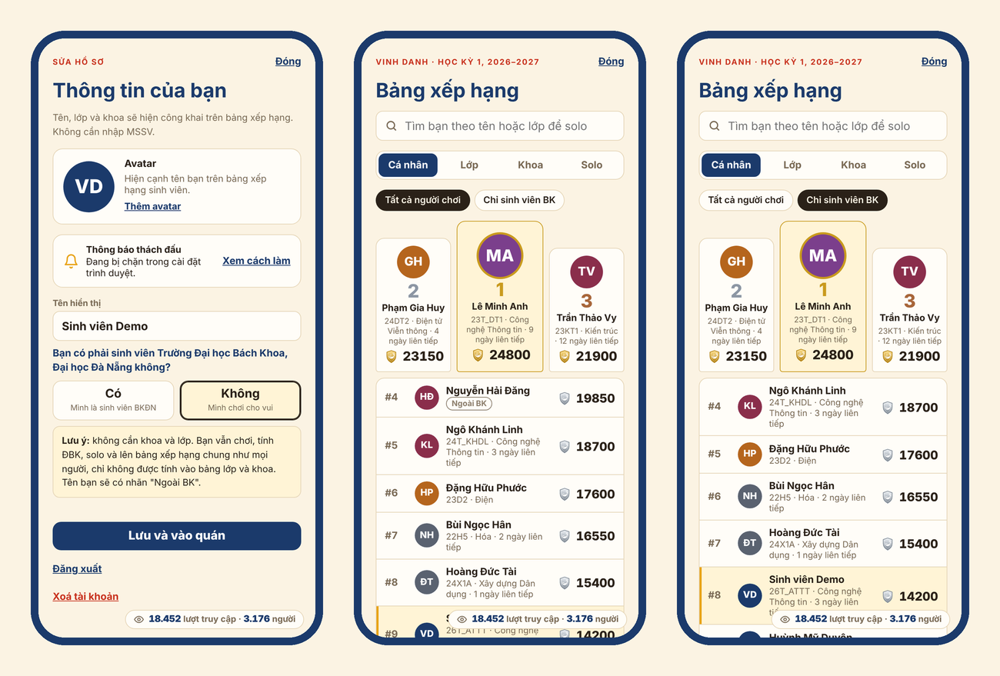</p>
- **Streak kiểu Duolingo**: chốt sổ ít nhất một lượt mỗi ngày để giữ lửa, bỏ một ngày là chuỗi về 0. Ngày được tính theo giờ Việt Nam (Asia/Ho_Chi_Minh). Có hiệu ứng ngọn lửa bùng lên và lịch tuần.
- **Xoá tài khoản** ngay trong game (cuối màn sửa hồ sơ, phải gõ XOÁ để xác nhận): xoá hẳn email, điểm, Elo, lịch sử, bạn bè, ảnh đại diện và biến mất khỏi bảng xếp hạng.
- **Bộ đếm truy cập** kiểu Facemash: đếm số lượt mở trang và số người đã ghé.

<p align="center">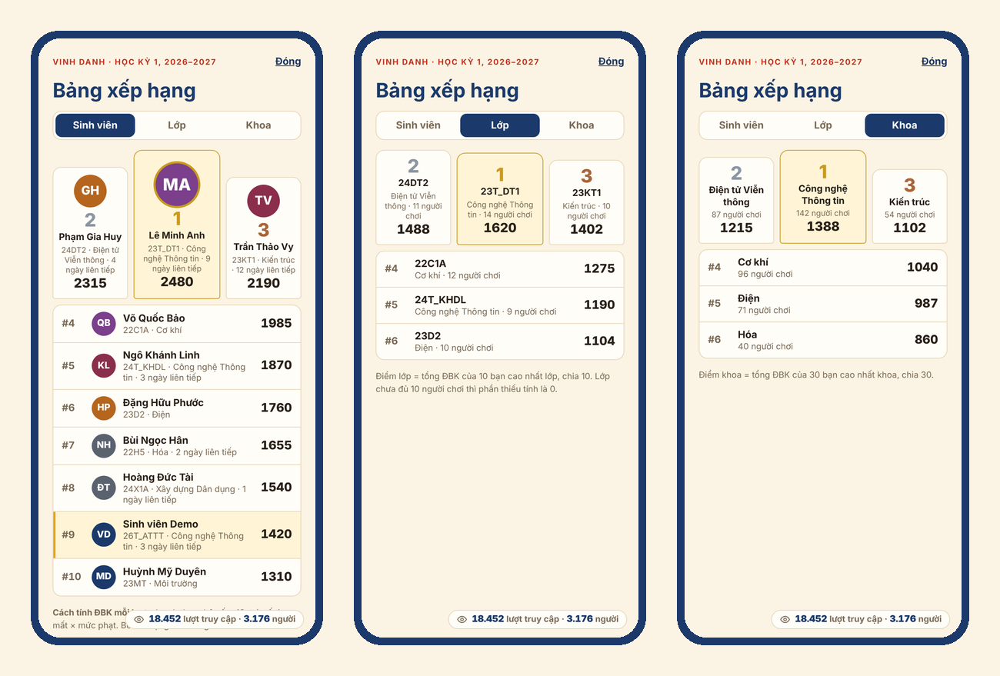</p>

<sub>Tên và điểm trong ảnh chụp màn hình là dữ liệu minh hoạ.</sub>

### Phân hạng

- **Hạng ĐBK** theo tổng điểm, kiểu Liên Quân: Đồng (dưới 10.000), Bạc (10.000), Vàng (20.000), Bạch Kim (50.000), Kim Cương (100.000), Tinh Anh (500.000), Cao Thủ (1.000.000). Mỗi hạng có huy hiệu vẽ bằng SVG (khiên và tô mì, hạng cao có thêm cánh, ngọc, vương miện), hiện ở thẻ tên, bảng xếp hạng và hồ sơ, kèm thanh tiến độ lên hạng kế tiếp.
- **Danh hiệu Elo solo** kiểu Codeforces, từ Newbie (dưới 1200) tới Legendary Grandmaster (3000+), chỉ là chữ có màu riêng; tên trên bảng Solo cũng tô theo màu đó. Màu được chỉnh lại cho giao diện tối để vẫn đọc rõ.

- **Màn lên / xuống hạng**: bán xong mà đổi hạng ĐBK, hoặc xong trận solo mà đổi danh hiệu Elo, game hiện một màn riêng trước màn kết quả. Lên hạng thì huy hiệu cũ mờ đi, huy hiệu mới phóng ra giữa vầng sáng xoay, kèm pháo giấy, tiếng kèn và rung máy; xuống hạng thì huy hiệu rơi nhẹ, xám dần, kèm lời động viên (còn bao nhiêu điểm nữa để lấy lại hạng cũ).

<p align="center">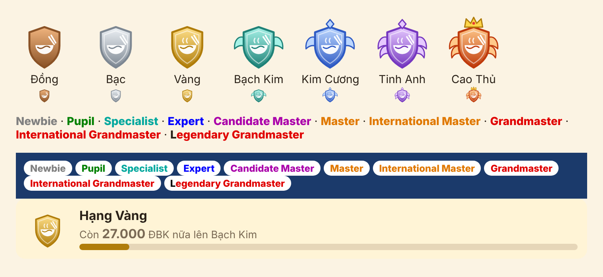</p>

### Solo: thách đấu bạn bè

Chế độ đấu trực tiếp hai người, lấy cảm hứng từ chess.com:

1. Tìm bạn bằng **ô tìm kiếm** (theo tên hoặc lớp), hoặc bấm vào tên một bạn trên **bảng xếp hạng**. Chấm xanh cạnh tên nghĩa là bạn đó đang mở game.
2. Người thách chọn **độ khó** và **luật thắng**:
   - *Sinh tồn*: ai hết tim trước thì thua. Cả hai trụ đủ 3 ngày thì so ĐBK.
   - *Điểm cao*: hết 3 ngày, ai nhiều ĐBK hơn thì thắng.
3. Người được thách nhận **thông báo ở góc dưới bên phải**, kèm âm thanh, có nút **Đồng ý / Từ chối** và 60 giây để trả lời. Nếu bạn ấy không mở game, điện thoại hoặc laptop vẫn hiện **thông báo hệ thống** (Web Push); bấm vào là mở game đúng lời thách. Trên iPhone cần thêm game vào Màn hình chính trước, và game có hướng dẫn từng bước.
4. Đồng ý xong, hai bên đếm ngược rồi cùng bán 3 ngày. Trong lúc bán, mỗi người thấy **ngày, doanh thu và số tim của đối thủ** cập nhật trực tiếp. Giữa các ngày vẫn có cửa hàng nâng cấp, nhưng không mua lại tim được.
5. Kết quả tính bằng **Elo** như cờ vua (bắt đầu 1200, K = 32): thắng người Elo cao hơn thì được cộng nhiều, thua người Elo thấp hơn thì bị trừ nhiều. Solo không cộng trừ ĐBK. Tab **Solo** trong bảng xếp hạng liệt kê mọi người chơi theo Elo; ai chưa đấu trận nào đứng ở mức 1200.

Trong trận có nút **Bỏ cuộc · Hoà** (trận vẫn chạy khi mở): bỏ cuộc thì chấp nhận thua; xin hoà thì đối thủ thấy lời đề nghị ở phía trên màn hình và có 20 giây để đồng ý (mỗi người xin tối đa 3 lần). Lỡ tải lại trang giữa trận thì game tự vào lại đúng trận sau 3 giây, giữ nguyên nâng cấp và tiền trong két. Rời trận quá 25 giây thì bị tính thua.

<p align="center">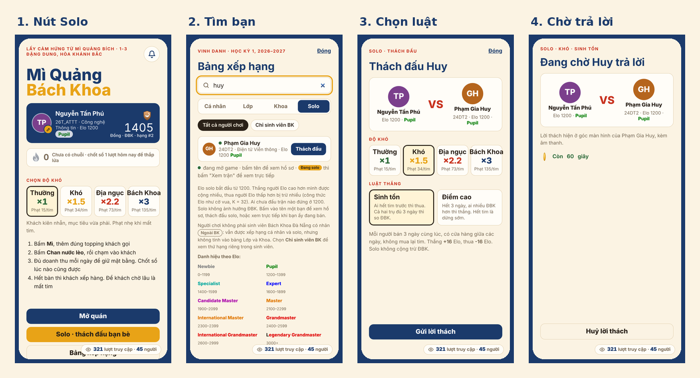</p>
<p align="center">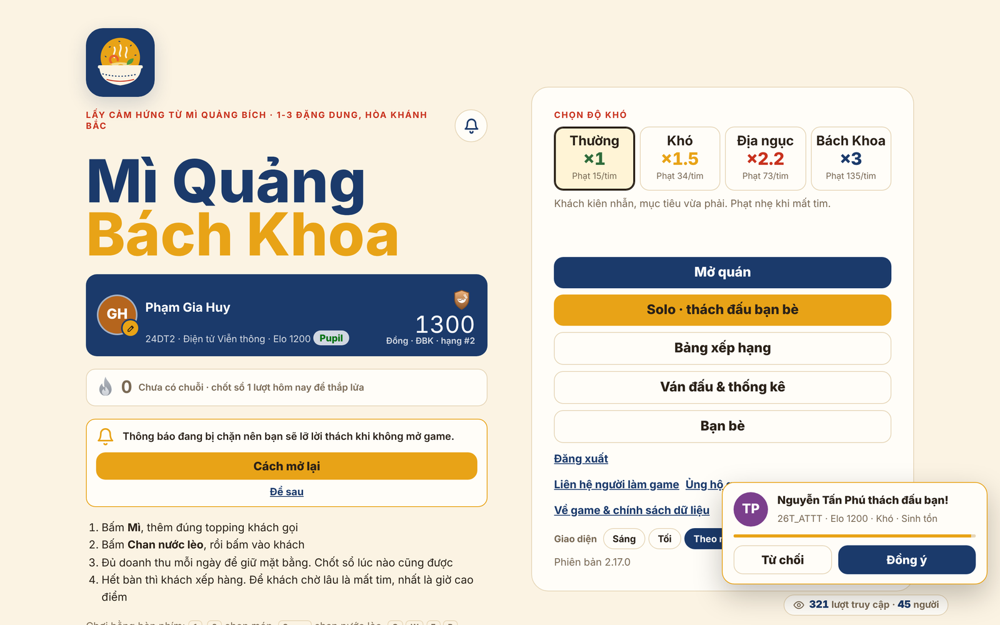</p>
<p align="center">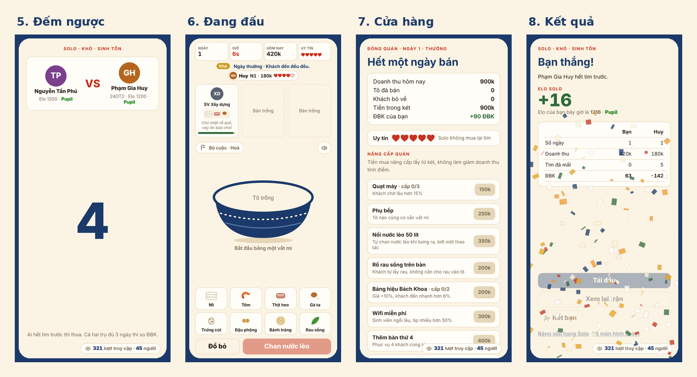</p>

### Ván đấu, xem lại và thống kê

Giống mục Games và Stats của chess.com:

- **Xem lại trận**: game không quay video mà **ghi lại từng thao tác** kèm thời điểm chính xác đến mili giây: khách đến, bỏ món nào, chan nước lèo, bưng cho bàn nào, sai món, khách bỏ về, mua nâng cấp, kể cả lúc tải lại trang. Khi xem lại, quán được dựng lại từ danh sách thao tác đó, nên thấy đúng nhịp nhanh chậm của người chơi. Trận solo hiện **hai quán cạnh nhau**, có nút phát/dừng, tua ±10 giây, tốc độ 1×–8×, thanh thời gian đánh dấu từng ngày, và danh sách diễn biến bấm vào để nhảy tới.
- **Ván solo**: danh sách trận mới nhất ở trên, có đối thủ (kèm Elo lúc đó), biểu tượng thắng/hoà/thua, độ khó, luật, lý do kết thúc, Elo được cộng hoặc trừ, ngày giờ.
- **Thống kê**: Elo hiện tại và cao nhất, tỉ lệ thắng/hoà/thua, tỉ lệ thắng theo từng luật, biểu đồ Elo sau mỗi trận. Phần mở quán thường có ĐBK trung bình mỗi lượt, tỉ lệ lượt có lời, lượt tốt nhất, số ngày trụ lâu nhất, chuỗi ngày hiện tại và dài nhất, biểu đồ ĐBK từng lượt, và bảng theo độ khó.
- Màu thắng/thua trong biểu đồ dùng **xanh dương–đỏ** thay vì xanh lá–đỏ, đã kiểm tra bằng công cụ đo để người mù màu vẫn phân biệt được; biểu tượng còn có dấu +, =, − nên không phụ thuộc vào màu.

- **Hồ sơ người khác**: bấm tên bất kỳ ai ở bảng xếp hạng hay ô tìm kiếm để xem thống kê, ván solo và lượt bán của họ, mở xem lại từng trận, rồi thách đấu ngay từ hồ sơ. Giống chess.com, lịch sử **đã kết thúc** là công khai với người đã đăng nhập; trận đang đấu, lời thách đang chờ và lượt đang chơi vẫn chỉ người trong cuộc đọc được.
- **Bạn bè và chuông thông báo**: tìm bạn ở mục Bạn bè, hoặc bấm "Kết bạn" trong hồ sơ, sau một trận solo hay ngay trên màn xem lại. Lời mời đến hiện trên chuông ở màn chính (có số chưa đọc, cập nhật tức thì qua Realtime); mục Bạn bè có danh sách bạn (ai đang mở game, đang bán, đang solo) và tab Lời mời đã nhận / đã gửi. Màn xem lại trận của người khác có luôn nút "Thách đấu".
- **Biểu đồ dễ xem trên điện thoại**: số liệu của cột đang chọn hiện ở dòng phía trên biểu đồ nên ngón tay không che; chạm rồi kéo ngang để lướt qua từng lượt, thả tay vẫn giữ.
- **Xem trực tiếp**: người đang bán hoặc đang solo có nút **Xem trực tiếp** (ở ô tìm kiếm là "Xem trận"). Màn xem dùng lại bộ dựng quán của phần xem lại, trễ khoảng nửa giây; trận solo hiện cả hai quán. Hết trận, màn xem báo ai thắng, Elo đổi bao nhiêu (hoặc người đó đã chốt sổ được bao nhiêu ĐBK) và hiện nút thách đấu người vừa rảnh. Dữ liệu đi qua Supabase Realtime Broadcast, máy người chơi chỉ gửi khi có người đang xem, không ghi gì vào database.

<p align="center">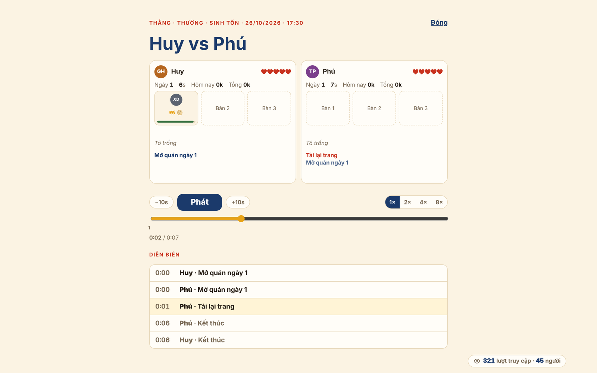</p>
<p align="center">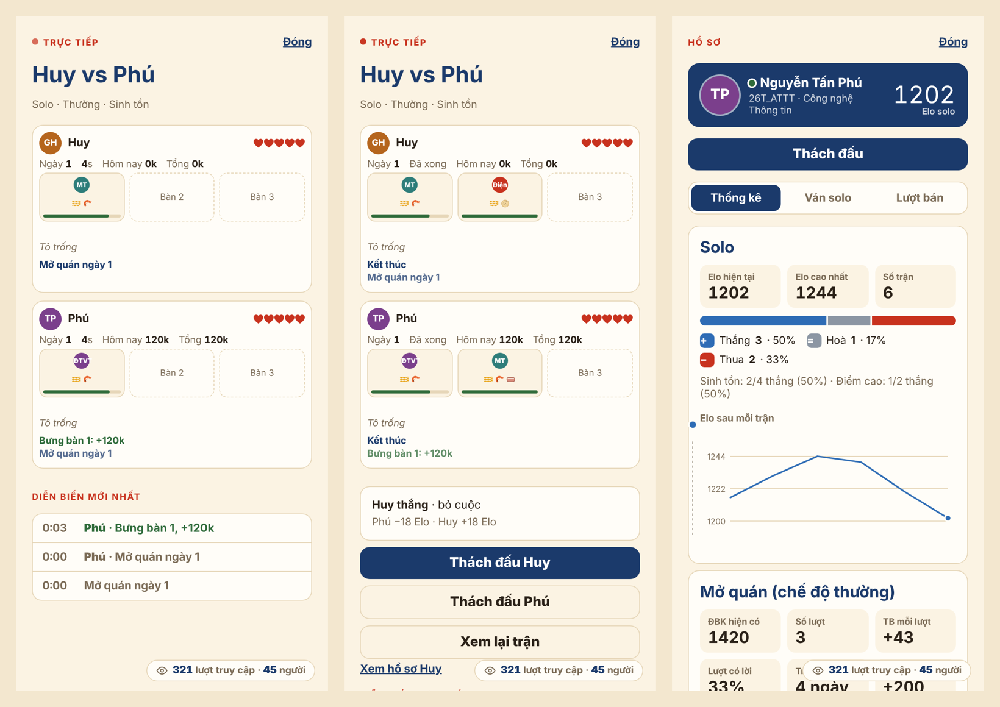</p>
<p align="center">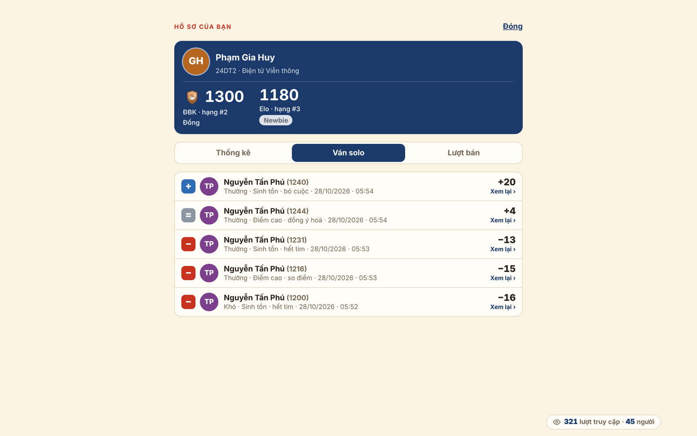</p>
<p align="center">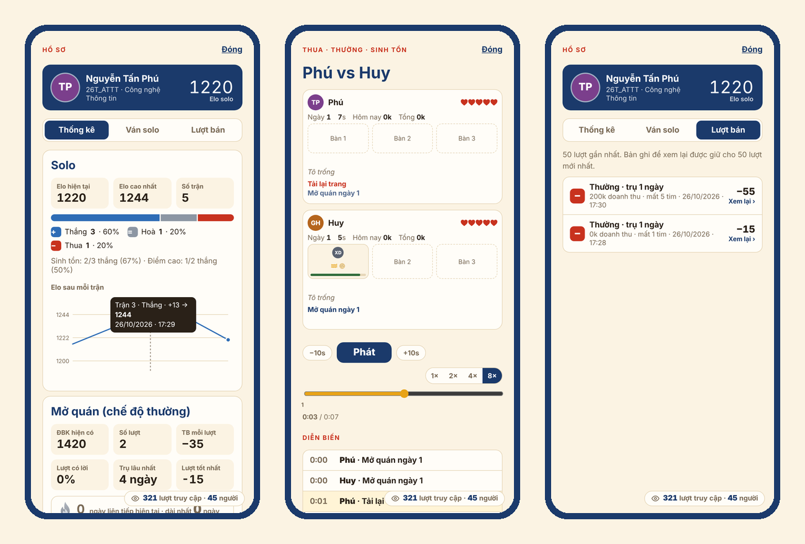</p>

## 6. Giao diện và trải nghiệm

- **Hai ngôn ngữ, tiếng Việt và tiếng Anh**, chuyển ở màn chính và màn đăng nhập (lưu trên máy). Bản tiếng Anh có tên **Bach Khoa Noodles** ("Bach Khoa" màu vàng, "Noodles" màu xanh), dịch toàn bộ chữ trong game, tên khoa, độ khó, nâng cấp, câu thoại khách, lỗi từ máy chủ và màn chính sách dữ liệu. Mọi chuỗi trong code viết dạng `tl('tiếng Việt', 'English')`; test tự động mở từng màn ở chế độ tiếng Anh và báo lỗi nếu còn sót chữ tiếng Việt.

<p align="center">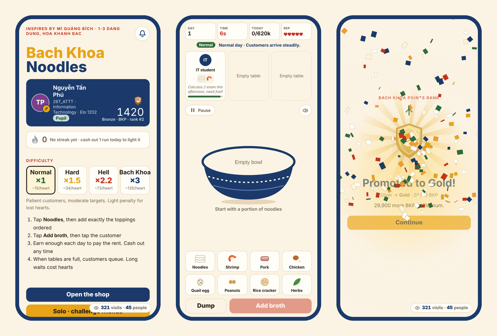</p>

- **Responsive**: trên điện thoại bố cục một cột, bếp nằm dưới; trên laptop chia hai cột, có thêm phím tắt.
- **Theme sáng, tối và theo máy**. Giao diện được đặt trước khi trang vẽ, nên không bị nháy trắng khi mở ở chế độ tối.
- **Âm thanh tự tổng hợp bằng Web Audio API**, không dùng file âm thanh nào: tiếng cho topping (mỗi món một cao độ), tiếng chan nước lèo, tiếng tiền, tiếng khách bỏ về, tiếng chốt sổ và đếm tiền.
- **Cài như ứng dụng (PWA)**, có icon riêng cho iOS và Android.
- **Chống bấm nhầm khi kết thúc lượt**: lúc thắng hoặc thua, màn hình dừng khoảng 2 giây và chặn mọi lần chạm. Thắng thì pháo giấy bắn từ dưới lên kèm tiếng kèn, thua thì màn hình xám lại, mưa rơi và rung nhẹ. Sau đó mới hiện kết quả, và các nút còn bị khoá thêm khoảng 1 giây. Cửa hàng cuối ngày và màn hết tim cũng khoá nút một nhịp ngắn. Nhờ vậy, người đang bấm liên tục ở cuối trận không lỡ tay bấm qua màn kết quả.
- **Giữ quán khi lỡ tải lại trang**: trạng thái lượt chơi được lưu trên máy mỗi giây, tải lại thì tự quay về đúng ngày đang bán (hoặc cửa hàng cuối ngày) sau 3 giây, không bị tính bỏ cuộc. Muốn dừng hẳn thì bấm **Tạm dừng → Đóng quán**; game báo trước số tim còn lại sẽ bị tính là mất và số ĐBK bị trừ.
- **Kéo xuống để tải lại** trên điện thoại (chỉ ở các màn không chơi; lúc đang bán thì tắt hẳn). Tính năng này tự tắt khi đang chơi để tránh lỡ tay.
- **Về game và chính sách dữ liệu**: màn riêng (mở từ màn chính và màn đăng nhập) ghi ngày game online lần đầu (24/10/2026), game thu thập dữ liệu gì, ai xem được gì, các biện pháp bảo mật, các bên dịch vụ liên quan (Supabase, GitHub Pages, Resend, jsDelivr, Google Fonts, dịch vụ thông báo của trình duyệt) kèm link chính sách riêng của từng bên, và cách yêu cầu xoá tài khoản.
- **Ảnh xem trước khi chia sẻ link** (Open Graph 1200×630) để link miquangbk.com hiện ảnh lớn trên Messenger, Facebook, Zalo.
- **Trang giới thiệu** [miquangbk.com/gioi-thieu/](https://miquangbk.com/gioi-thieu/): landing page tĩnh, đọc được không cần JavaScript (cho công cụ tìm kiếm), có ảnh màn hình thật của game, huy hiệu hạng và icon món chép từ mã game, phần hỏi nhanh khai báo dạng FAQ cho Google.
- **Phim giới thiệu 14,5 giây** dựng bằng code (`docs/phim`): camera bay một mạch qua trang giới thiệu, thẻ và ảnh nổi lên khi camera đi qua, độ sâu trường ảnh tính từng điểm ảnh, nhoè chuyển động, rồi lặn xuống đặt phần hero thành thẻ dưới câu "Mở quán thôi. / *Cả trường đang chờ.*". Âm thanh cũng tổng hợp bằng code. Tốc độ camera được kiểm tra lại bằng optical flow trên bản xem nhanh.

<p align="center">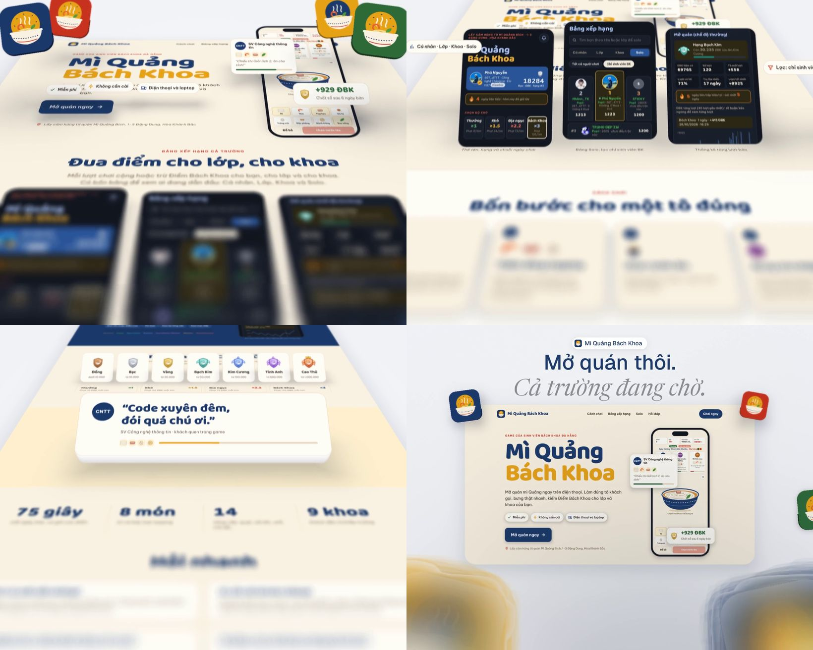</p>
- **Tiếp cận**: có nhãn `aria`, điều khiển được bằng bàn phím, và tôn trọng cài đặt giảm chuyển động (`prefers-reduced-motion`).

<p align="center">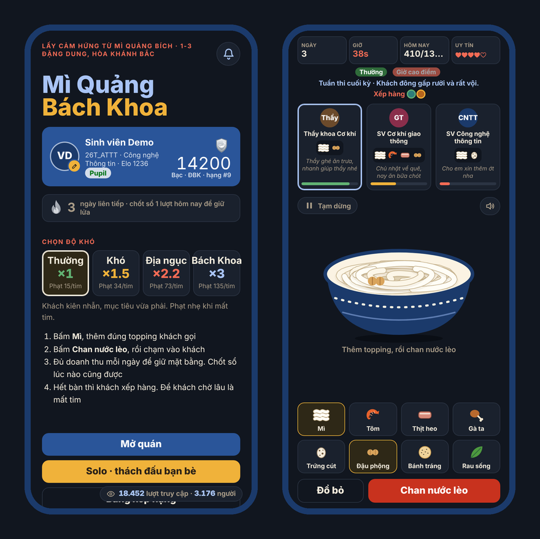</p>

<p align="center">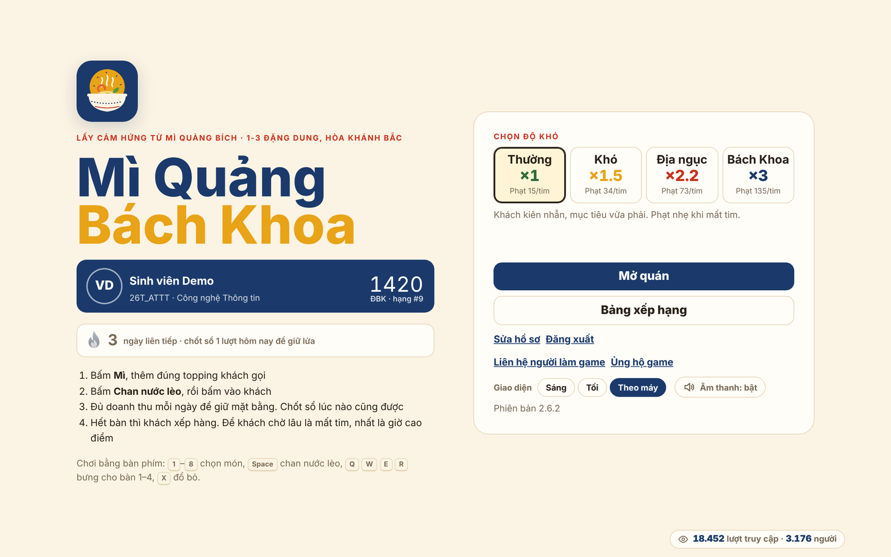</p>

## 7. Kiến trúc kỹ thuật

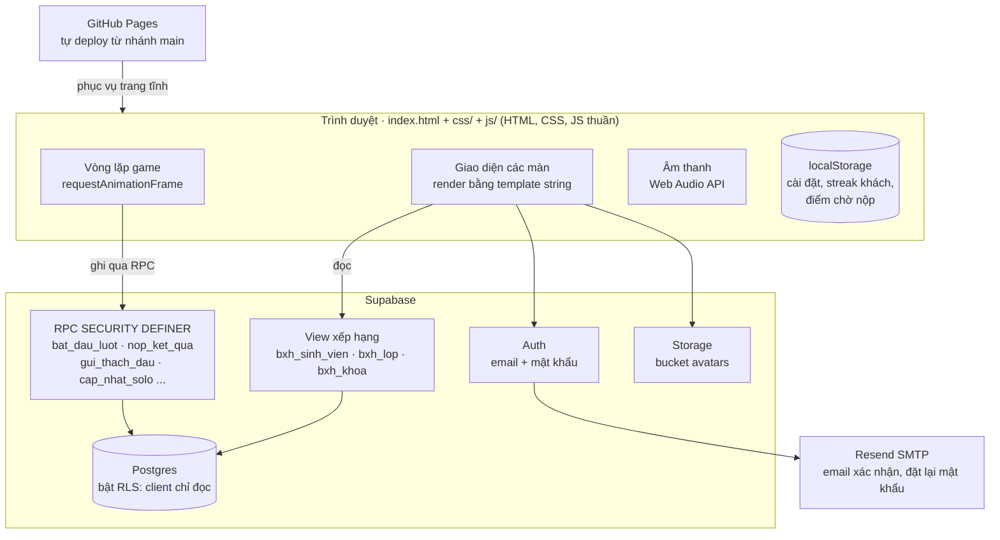

| Thành phần | Công nghệ |
|---|---|
| Giao diện, logic game | HTML, CSS, JavaScript thuần (không framework, không bước build), toàn bộ trong một file khoảng 1.400 dòng |
| Đồ hoạ | SVG vẽ tay ngay trong code (tô mì, nguyên liệu, ngọn lửa streak) |
| Âm thanh | Web Audio API (oscillator và noise lọc qua filter) |
| Backend | Supabase: Postgres, Auth, Storage, RPC bằng PL/pgSQL |
| Email | Resend qua SMTP, mẫu email HTML riêng |
| Hosting | GitHub Pages |
| Kiểm thử | Kiểm tra cú pháp bằng `node --check`, kiểm thử giao diện bằng Playwright (Python) |

### Dữ liệu trên Supabase

| Bảng hoặc view | Nội dung |
|---|---|
| `khoa` | Danh sách khoa |
| `profiles` | Hồ sơ người chơi: tên, có phải sinh viên BKĐN (`sinh_vien`), khoa và lớp (để trống nếu không phải sinh viên), tổng điểm, số lượt, streak, avatar |
| `runs` | Từng lượt chơi: độ khó, trạng thái, số ngày, doanh thu, tim mất, điểm cộng/trừ, thời gian |
| `thach_dau` | Lời thách và trận solo: hai người chơi, độ khó, luật, tiến độ từng bên, người thắng, Elo trước và sau |
| `bxh_solo` | View xếp hạng Solo theo Elo |
| `push_sub` | Đăng ký nhận thông báo đẩy của từng máy (tối đa 10 máy mỗi người) |
| `ban_ghi` | Bản ghi thao tác để xem lại: mỗi người một bản cho mỗi trận solo (giữ hết) hoặc lượt thường (giữ 50 lượt mới nhất) |
| `luot_truy_cap`, `khach_ghe`, `thong_ke` | Thống kê lượt truy cập |
| `bxh_sinh_vien`, `bxh_lop`, `bxh_khoa` | View tính bảng xếp hạng |

## 8. Những bài toán kỹ thuật đáng chú ý

**Chống gian lận điểm.** Client chỉ có quyền đọc, nhờ Row Level Security. Mọi thao tác ghi đều đi qua hàm RPC `SECURITY DEFINER` trên server:

- `bat_dau_luot` mở một lượt trên server trước khi chơi.
- `nop_ket_qua` tự tính lại điểm bằng hệ số độ khó của server (hàm `he_so()`), và từ chối số liệu vô lý: doanh thu tối đa 5.000k mỗi ngày, số tim mất không quá 5 + doanh thu ÷ 500.
- Lượt bị bỏ dở được xử lý như mất cả 5 tim, nên người chơi không thể thoát game để né điểm phạt.

**Không mất điểm khi mạng chập chờn.** Safari trên iOS hay báo lỗi `Load failed` khi dùng lại kết nối cũ. Kết quả lượt chơi vì thế được **lưu vào localStorage trước khi gửi**. Game gửi lại tự động kèm cơ chế thử lại (`rpcRetry`), và nếu vẫn lỗi thì lần mở game sau trên máy đó sẽ tự nộp (`flushPending`). Lượt đang chờ nộp không bị tính là bỏ dở.

**Solo realtime mà vẫn chống gian lận.** Thông báo thách đấu và tiến độ đối thủ đến qua Supabase Realtime, nhưng RLS chỉ cho mỗi người đọc trận đang đấu của chính mình (trận đã xong mới công khai). Mọi thay đổi đều đi qua RPC trên server (`gui_thach_dau`, `tra_loi_thach_dau`, `cap_nhat_solo`…). Server kiểm tra doanh thu không giảm, tim mất không giảm, thời gian chơi khớp số ngày, rồi tự phân thắng thua và tính Elo. Thông báo hệ thống đi theo đường: lời thách mới → trigger Postgres gọi Edge Function `thong-bao-thach-dau` qua `pg_net` → hàm gửi Web Push (khoá VAPID cất trong Supabase Vault) → `sw.js` hiện thông báo, và bỏ qua nếu game đang mở trước mặt để không báo hai lần. Người chơi phải báo về mỗi 4 giây; ai im lặng quá 25 giây bị xử thua, nên không thể tắt game để né trận thua.

**Xem trực tiếp mà không tốn database.** Mỗi người chơi giữ một kênh Broadcast `xem:<id>`. Người xem gửi lời "chào" kèm số sự kiện đã có, 8 giây một lần; còn người xem thì máy người chơi gửi phần sự kiện mới mỗi 0,6 giây (thiếu đoạn nào thì người xem xin gửi lại từ đó). Thời gian được tính theo đồng hồ của người chơi (số mili giây từ lúc mở quán) nên lệch giờ giữa hai máy không làm sai nhịp. Kết quả cuối (Elo, ĐBK) được gửi kèm sau khi server tính xong.

**Cân bằng độ khó bằng mô phỏng.** Mục tiêu doanh thu mỗi ngày không đặt theo cảm tính. Chúng được lấy từ mô phỏng 2.000 ván với chiến lược của người chơi khá, có mua nâng cấp dần, rồi nhân thêm một tỉ lệ tăng theo ngày.

**Streak theo đúng múi giờ.** Ngày giữ lửa được tính theo giờ Việt Nam ở cả hai phía: trên server cho người có tài khoản, và trên máy cho người chơi thử. Nhờ vậy không lệch ngày khi máy người chơi để múi giờ khác.

**Không phụ thuộc tài nguyên ngoài.** Không có file ảnh hay âm thanh cho gameplay: mọi hình vẽ là SVG và mọi âm thanh được tổng hợp lúc chạy. Trang tải nhanh, và repo rất gọn.

**Avatar xử lý ngay trên trình duyệt.** Ảnh được thu nhỏ và cắt theo khung bằng Canvas trước khi tải lên Storage, nên giảm dung lượng mà không cần server xử lý ảnh.

## 9. Cấu trúc thư mục

```
mi-quang-bach-khoa/
├── index.html               # Khung trang: HTML của màn chơi, nạp CSS và các file JS theo thứ tự
├── css/giao-dien.css        # Toàn bộ giao diện, biến màu cho chế độ sáng/tối
├── js/                      # Mã game, mỗi file một phần (script thường, dùng chung biến toàn cục)
│   ├── hang.js              # Hạng ĐBK (huy hiệu SVG) và danh hiệu Elo
│   ├── cau-hinh.js          # Cấu hình Supabase, phiên bản, dữ liệu game, biến trạng thái
│   ├── vong-choi.js         # Vòng chơi: khách, làm tô, bưng, hết ngày, mất tim
│   ├── hien-thi.js          # Vẽ màn chơi
│   ├── huong-dan.js         # Người mới: ngày khai trương, chỉ tay 3 tô đầu, giữ lượt chơi thử
│   ├── am-thanh.js          # Âm thanh tổng hợp bằng Web Audio
│   ├── mang.js              # Gọi RPC có thử lại
│   ├── nop-diem.js          # Streak, kết thúc lượt, nộp điểm
│   ├── tai-khoan.js         # Đăng nhập, sửa hồ sơ, avatar
│   ├── man-hinh.js          # Màn chính, cửa hàng, bảng xếp hạng, liên hệ, ủng hộ, giao diện
│   ├── solo.js              # Solo: thách đấu, realtime, Elo
│   ├── thong-bao.js         # Thông báo đẩy
│   ├── hieu-ung.js          # Hiệu ứng thắng/thua, khoá nút chống bấm nhầm
│   ├── giu-quan.js          # Giữ quán khi tải lại, tạm dừng, đóng quán
│   ├── ngon-ngu.js          # Song ngữ Việt / Anh: tl(), tên khoa, dịch lỗi máy chủ (nạp đầu tiên)
│   ├── ban-ghi.js           # Ghi thao tác, xem lại, hồ sơ, biểu đồ, xem trực tiếp
│   ├── ban-be.js            # Bạn bè, lời mời kết bạn, chuông thông báo
│   ├── ve-game.js           # Màn "Về game": thông tin, chính sách dữ liệu và bảo mật
│   ├── dieu-huong.js        # Nhớ màn đang mở để tải lại trang vẫn ở đúng chỗ
│   └── khoi-dong.js         # Khởi động: đăng nhập, vào lại lượt/trận đang dở
├── sw.js                    # Service worker nhận thông báo thách đấu
├── manifest.webmanifest     # Cấu hình PWA
├── icons/                   # Favicon, icon PWA, ảnh xem trước khi chia sẻ link (og-image.png), mã QR ủng hộ
├── emails/
│   ├── xac-nhan-email.html  # Mẫu email xác nhận tài khoản
│   └── dat-lai-mat-khau.html# Mẫu email đặt lại mật khẩu
├── supabase/
│   ├── schema.sql           # Toàn bộ cấu trúc database: bảng, RLS, view, 23 hàm RPC, trigger
│   ├── functions/           # Edge Function gửi thông báo đẩy
│   └── README.md            # Cách dựng lại backend trên project mới
├── gioi-thieu/              # Trang giới thiệu (landing page tĩnh) và ảnh màn hình của nó
├── robots.txt, sitemap.xml, llms.txt   # Cho công cụ tìm kiếm và trợ lý AI
├── tests/                   # Kiểm thử tự động (xem tests/README.md)
├── .github/workflows/       # GitHub Actions chạy kiểm thử mỗi lần push
├── docs/images/             # Ảnh minh hoạ cho README
├── docs/phim/               # Dựng phim giới thiệu: chụp trang, trang WebGL2 vẽ từng khung, render, âm thanh (xem docs/phim/README.md)
└── CLAUDE.md                # Ghi chú kỹ thuật cho người phát triển
```

Các phần chính trong `js/`, tìm theo tên:

| Phần | Tên trong code |
|---|---|
| Dữ liệu game | `ING` (nguyên liệu), `KHACH`, `LINES`, `EVENTS`, `UPG`, `DIFF`, `REF` |
| Vòng chơi | `newGame`, `startDay`, `spawn`, `seatQueue`, `loop`, `serve`, `endDay`, `loseHeart` |
| Cửa hàng, tim | `showShop`, `drawShop`, `buyHeart`, `reviveScreen` |
| Nộp điểm | `finishRun`, `rpcRetry`, `savePending`, `flushPending` |
| Âm thanh | `SFX`, `tone`, `noise`, `sfx` |
| Streak | `streakState`, `streakScreen`, `flameSVG` |
| Tài khoản, avatar | `authScreen`, `profileScreen`, `avatarEditor` |
| Bảng xếp hạng, tìm người chơi | `leaderboard`, `loadBoard`, `searchPlayers`, `ruleText` |
| Solo | `soloConnect`, `showNotice`, `challengeScreen`, `startSolo`, `soloPush`, `soloEnd` |
| Thông báo đẩy | `swInit`, `pushCard`, `enablePush`, `pushResync`, `openThach` (và `sw.js`) |
| Ghi và xem lại, hồ sơ, xem trực tiếp (`js/ban-ghi.js`) | `recStart`, `rec`, `recUpload`, `replayScreen`, `rpApply`, `hoSoScreen`, `statsTab`, `gamesTab`, `liveOpen`, `liveTick`, `watchScreen`, `lineChart`, `barChart` |
| Giao diện, điều hướng | `applyTheme`, `home`, `nhoMan`, `moLaiMan` (`js/dieu-huong.js`) |

## 10. Chạy thử trên máy

Game là trang tĩnh, không cần cài đặt gì thêm:

```bash
git clone https://github.com/phu759042-source/mi-quang-bach-khoa.git
cd mi-quang-bach-khoa
python3 -m http.server 8000
# mở http://localhost:8000
```

Nếu không kết nối được Supabase, game tự chuyển sang **chế độ chơi thử** và vẫn chơi đầy đủ, chỉ không tính điểm. Muốn dùng backend riêng, hãy đổi `SB_URL` và `SB_KEY` trong `js/cau-hinh.js`.

### Kiểm thử tự động

Mỗi lần push lên `main`, GitHub Actions chạy ba bài kiểm tra:
- cú pháp JavaScript;
- **dựng lại database từ `supabase/schema.sql`** trên một Postgres trống, rồi thử các luật server (chống gian lận khi nộp điểm, quyền đọc trận solo, Elo, trigger thông báo);
- **chơi thật bằng hai trình duyệt** (điện thoại và laptop) với server giả lập cùng luật: thách đấu, thông báo, Sinh tồn, Điểm cao, hiệu ứng thắng/thua, tải lại trang giữa trận, xem lại, hồ sơ người khác, và xem trực tiếp bằng trình duyệt thứ ba.

Cách chạy trên máy ở [tests/README.md](tests/README.md). Cách dựng lại backend trên project Supabase mới ở [supabase/README.md](supabase/README.md).

## 11. Cách mình làm dự án này

Dự án được làm cùng **Claude**, trợ lý AI của Anthropic. Mình đóng vai người làm sản phẩm: đưa ra ý tưởng, chọn bối cảnh, quyết định tính năng, trình bày yêu cầu và duyệt kết quả. Claude làm phần kỹ thuật theo hướng mình đặt ra, và góp thêm một số ý tưởng về lối chơi. Phân công cụ thể:

| Phần việc | Người phụ trách |
|---|---|
| Ý tưởng ban đầu: một game đậm chất Bách Khoa Đà Nẵng | Mình |
| Bối cảnh thật: quán Mì Quảng Bích ở Đặng Dung, Hòa Khánh Bắc | Mình. Claude đề xuất món mì Quảng nhưng đặt quán ở trước cổng trường, nơi không có quán mì nào, nên mình sửa lại cho đúng thực tế |
| Hệ thống độ khó | Mình quyết định |
| Quản lý tài khoản: lưu người chơi trên Supabase, tổ chức theo lớp và theo khoa | Mình quyết định |
| Chế độ Solo kiểu chess.com: thách qua tìm kiếm hoặc bảng xếp hạng, thông báo góc dưới bên phải có âm thanh, hai luật thắng, tính Elo theo chênh lệch | Ý tưởng và luật của mình. Claude đề xuất chi tiết (3 ngày, không mua tim, xử thua khi rời trận) và mình duyệt |
| Hồ sơ người chơi, cách hiển thị dữ liệu, bảng xếp hạng | Mình quyết định |
| Giao diện sáng/tối, ảnh đại diện | Mình quyết định |
| Có hiệu ứng âm thanh | Mình quyết định. Claude đề xuất và thiết kế từng tiếng |
| Topping, lối chơi lõi (ghép tô, kiên nhẫn của khách, giờ cao điểm) | Ý tưởng của Claude |
| Toàn bộ code: giao diện, logic game, đồ hoạ SVG, âm thanh Web Audio | Claude viết |
| Backend Supabase: bảng, RLS, RPC, realtime, chống gian lận, tính Elo, cân bằng bằng mô phỏng | Claude viết |

Cách làm này giúp mình đưa một ý tưởng thành sản phẩm chạy thật, có tài khoản, có bảng xếp hạng toàn trường.
## 12. Tác giả

**Nguyễn Tấn Phú**, sinh viên lớp 26T_ATTT, khoa Công nghệ Thông tin, Đại học Bách Khoa Đà Nẵng.
Email: phu759042@gmail.com

Người lên ý tưởng và định hướng sản phẩm. Phần kỹ thuật do Claude thực hiện, như mô tả ở mục 11.
