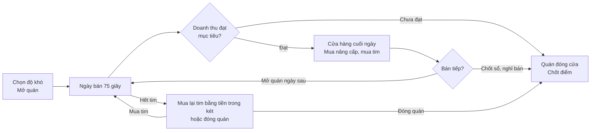
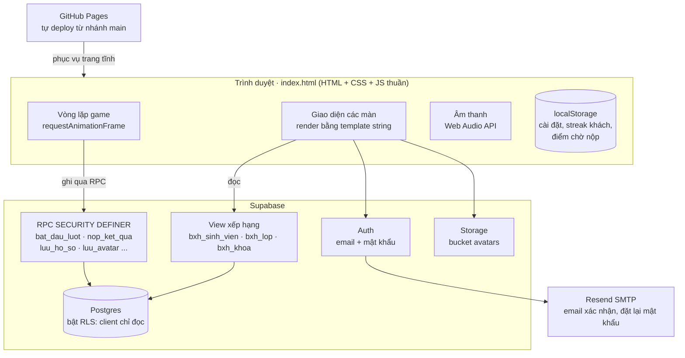

<div align="center">


# Mì Quảng Bách Khoa

**Game quản lý quán mì Quảng trên web, viết cho sinh viên Đại học Bách Khoa Đà Nẵng.**
Bán mì cho sinh viên các khoa, giữ uy tín quán, rồi đua điểm theo cá nhân, theo lớp và theo khoa.

[**▶ Chơi ngay**](https://phu759042-source.github.io/mi-quang-bach-khoa/) · chạy trên điện thoại và laptop, cài được như ứng dụng (PWA)


</div>

> **In English.** *Mì Quảng Bách Khoa* is a browser-based restaurant time-management game built for students of the University of Science and Technology, University of Da Nang. Players assemble bowls of mì Quảng (a central-Vietnamese noodle dish) against customer patience timers, upgrade their shop between days, and compete on student, class and faculty leaderboards. It is a single-file HTML/CSS/vanilla JS app (no build step, no framework) backed by Supabase (Postgres + Auth + Storage), with server-side score validation via `SECURITY DEFINER` RPCs and row-level security, offline-safe score submission, Duolingo-style daily streaks, and sound effects synthesised entirely with the Web Audio API.

---

## Mục lục

1. [Ý tưởng](#1-ý-tưởng)
2. [Cách chơi](#2-cách-chơi)
3. [Độ khó và cách tính điểm](#3-độ-khó-và-cách-tính-điểm)
4. [Nâng cấp quán](#4-nâng-cấp-quán)
5. [Tài khoản, bảng xếp hạng và streak](#5-tài-khoản-bảng-xếp-hạng-và-streak)
6. [Giao diện và trải nghiệm](#6-giao-diện-và-trải-nghiệm)
7. [Kiến trúc kỹ thuật](#7-kiến-trúc-kỹ-thuật)
8. [Những bài toán kỹ thuật đáng chú ý](#8-những-bài-toán-kỹ-thuật-đáng-chú-ý)
9. [Cấu trúc thư mục](#9-cấu-trúc-thư-mục)
10. [Chạy thử trên máy](#10-chạy-thử-trên-máy)
11. [Tác giả](#11-tác-giả)

---

## 1. Ý tưởng

Game lấy cảm hứng từ **Mì Quảng Bích** (1-3 Đặng Dung, Hòa Khánh Bắc, Liên Chiểu), một quán quen của sinh viên Bách Khoa. Người chơi là chủ quán. Khách là sinh viên của 9 khoa: CNTT, Cơ khí, Điện, Xây dựng, Hóa, Điện tử viễn thông, Kiến trúc, Môi trường và Cơ khí giao thông. Câu thoại của khách lấy từ đời sống sinh viên, ví dụ "Chiều thi Giải tích 2, ăn cho tỉnh!" hay "Code xuyên đêm, đói quá chú ơi".

Mục tiêu của dự án:

- Một game **chơi nhanh**, mỗi ngày trong game chỉ 75 giây, hợp với giờ nghỉ giữa tiết.
- **Tạo tinh thần thi đua** giữa các lớp và các khoa, nhờ bảng xếp hạng chung toàn trường.
- **Kéo người chơi quay lại mỗi ngày** bằng chuỗi ngày liên tiếp (streak) kiểu Duolingo.

## 2. Cách chơi

<p align="center"></p>

### Vòng lặp một ngày bán



### Thao tác làm một tô mì

1. Bấm **Mì** để cho vắt mì vào tô.
2. Thêm **đúng các topping** khách gọi. Có 7 loại: tôm, thịt heo, gà ta, trứng cút, đậu phộng, bánh tráng, rau sống.
3. Bấm **Chan nước lèo**.
4. Bấm vào khách để bưng ra. Nếu làm sai, bấm **Đổ bỏ** để làm lại.

| Phím (laptop) | Tác dụng |
|---|---|
| `1` – `8` | Chọn nguyên liệu (Mì, Tôm, Thịt heo, Gà ta, Trứng cút, Đậu phộng, Bánh tráng, Rau sống) |
| `Space` | Chan nước lèo |
| `Q` `W` `E` `R` | Bưng cho bàn 1, 2, 3, 4 |
| `X` hoặc `Backspace` | Đổ bỏ tô đang làm |

### Khách, thời gian và uy tín

- Mỗi khách có **thanh kiên nhẫn**, màu chuyển xanh → vàng → đỏ. Hết bàn thì khách phải **xếp hàng**, và hàng chờ cũng có giới hạn kiên nhẫn riêng.
- Bưng sai món, hoặc để khách chờ quá lâu, quán **mất 1 tim uy tín**. Quán có tối đa 5 tim.
- Khách được phục vụ nhanh sẽ **tip nhiều hơn**. Thỉnh thoảng có **thầy ghé ăn**: trả giá gấp đôi nhưng vội hơn sinh viên.
- **Giờ cao điểm**: khi đồng hồ còn từ 45 đến 25 giây, khách đến nhanh gấp đôi.
- Bốn kiểu ngày xoay vòng, mỗi kiểu đổi nhịp khách và tiền tip:

| Kiểu ngày | Đặc điểm |
|---|---|
| Ngày thường | Khách đến đều đều |
| Giờ tan học | Khách đông hơn một chút |
| Tuần thi cuối kỳ | Khách đông gấp rưỡi và rất vội |
| Mưa bão miền Trung | Ít khách, nhưng ai ghé cũng tip gấp đôi |

- Mỗi ngày có **mục tiêu doanh thu** (tiền mặt bằng). Không đạt mục tiêu thì quán đóng cửa và lượt chơi kết thúc. Mục tiêu được hiệu chỉnh từ **mô phỏng 2.000 ván** của một người chơi khá, rồi tăng dần qua từng ngày.
- **Hết tim giữa ngày** thì game tạm dừng. Người chơi có thể bỏ 500k trong két ra mua lại 1 tim để bán tiếp, hoặc đóng quán và chốt điểm.

## 3. Độ khó và cách tính điểm

Trước mỗi lượt, người chơi chọn một trong 4 mức. Mức càng cao thì khách càng vội, tô càng nhiều topping, mục tiêu càng cao, đổi lại điểm thưởng được nhân lớn hơn.

| Độ khó | Hệ số thưởng | Phạt mỗi tim mất | Mất cả 5 tim |
|---|---|---|---|
| Thường | ×1 | −15 | −75 |
| Khó | ×1.5 | −34 | −169 |
| Địa ngục | ×2.2 | −73 | −363 |
| Bách Khoa | ×3 | −135 | −675 |

**Điểm Bách Khoa (ĐBK)** của một lượt:

```
ĐBK = tổng doanh thu × hệ số ÷ 10  −  số tim đã mất × 15 × hệ số²
```

Mua lại tim **không xoá điểm phạt**. Tiền mua tim và mua nâng cấp lấy từ két, không làm giảm doanh thu tính điểm. Bỏ dở lượt giữa chừng thì tính như mất cả 5 tim.

Vì vậy, quyết định **chốt sổ lúc nào** là một phần chiến thuật: bán thêm ngày thì có thêm doanh thu, nhưng mục tiêu tăng lên và rủi ro mất tim cũng lớn hơn.

<p align="center"></p>

## 4. Nâng cấp quán

Cuối mỗi ngày, người chơi dùng tiền trong két để mua nâng cấp. Có **14 dòng nâng cấp**, một số dòng có nhiều cấp:

| Nâng cấp | Tác dụng | Giá |
|---|---|---|
| Quạt máy → Quạt hơi nước → Máy lạnh | Khách chờ lâu hơn 15% / 30% / 45% | 150k / 300k / 550k |
| Phụ bếp | Tô nào cũng có sẵn vắt mì | 250k |
| Nồi nước lèo 50 lít | Tự chan nước lèo khi bưng ra | 350k |
| Rổ rau sống trên bàn | Khách tự lấy rau, không cần cho rau vào tô | 200k |
| Bảng hiệu Bách Khoa → Bảng đèn LED | Giá +10% / +20%, khách đến nhanh hơn | 200k / 450k |
| Wifi miễn phí | Sinh viên ngồi lâu, tip nhiều hơn 50% | 300k |
| Thêm bàn thứ 4 | Phục vụ 4 khách cùng lúc | 400k |
| Thẻ tích điểm sinh viên | Mỗi ngày giữ chân 1 khách sắp bỏ về | 500k |
| Ghế chờ có mái che → Trà đá miễn phí | Hàng chờ dài hơn, khách xếp hàng kiên nhẫn hơn | 300k / 550k |
| Fanpage quán → Video TikTok viral | Khách đến nhanh hơn 10% / 20%, thêm tip | 250k / 600k |
| TV chiếu LMHT, Valorant | Giờ cao điểm khách kiên nhẫn hơn 30% | 300k |
| Thực đơn combo sinh viên | Một nửa số khách gọi bớt 1 món | 350k |
| Thanh toán QR | Khách trả nhanh, mỗi tô thêm 3k | 200k |
| Nhân viên chạy bàn | Tô vừa chan xong tự bưng tới khách gọi đúng món | 700k |

<p align="center"></p>

## 5. Tài khoản, bảng xếp hạng và streak

<p align="center"></p>

- **Chơi thử không cần tài khoản.** Lượt chơi thử không tính điểm, chỉ lưu kỷ lục trên máy.
- **Đăng ký bằng email**, có xác nhận email và đặt lại mật khẩu. Email gửi qua Resend với mẫu HTML riêng.
- **Hồ sơ**: tên, khoa, lớp, và **ảnh đại diện** có công cụ cắt và phóng to ngay trong game.
- **Bảng xếp hạng ba cấp**:
  - *Sinh viên*: tổng ĐBK của từng người.
  - *Lớp*: tổng ĐBK của 10 bạn cao nhất lớp, chia 10.
  - *Khoa*: tổng ĐBK của 30 bạn cao nhất khoa, chia 30.

  Cách tính này giúp lớp ít người vẫn cạnh tranh được, và một cá nhân "cày" nhiều không kéo cả lớp lên một mình.
- **Streak kiểu Duolingo**: chốt sổ ít nhất một lượt mỗi ngày để giữ lửa, bỏ một ngày là chuỗi về 0. Ngày được tính theo giờ Việt Nam (Asia/Ho_Chi_Minh). Có hiệu ứng ngọn lửa bùng lên và lịch tuần.
- **Bộ đếm truy cập** kiểu Facemash: đếm số lượt mở trang và số người đã ghé.

<p align="center"></p>

<sub>Tên và điểm trong ảnh chụp màn hình là dữ liệu minh hoạ.</sub>

## 6. Giao diện và trải nghiệm

- **Responsive**: trên điện thoại bố cục một cột, bếp nằm dưới; trên laptop chia hai cột, có thêm phím tắt.
- **Theme sáng, tối và theo máy**. Giao diện được đặt trước khi trang vẽ, nên không bị nháy trắng khi mở ở chế độ tối.
- **Âm thanh tự tổng hợp bằng Web Audio API**, không dùng file âm thanh nào: tiếng cho topping (mỗi món một cao độ), tiếng chan nước lèo, tiếng tiền, tiếng khách bỏ về, tiếng chốt sổ và đếm tiền.
- **Cài như ứng dụng (PWA)**, có icon riêng cho iOS và Android.
- **Kéo xuống để tải lại** trên điện thoại. Tính năng này tự tắt khi đang chơi để tránh lỡ tay.
- **Tiếp cận**: có nhãn `aria`, điều khiển được bằng bàn phím, và tôn trọng cài đặt giảm chuyển động (`prefers-reduced-motion`).

<p align="center"></p>

<p align="center"></p>

## 7. Kiến trúc kỹ thuật



| Thành phần | Công nghệ |
|---|---|
| Giao diện, logic game | HTML, CSS, JavaScript thuần (không framework, không bước build), toàn bộ trong một file khoảng 1.400 dòng |
| Đồ hoạ | SVG vẽ tay ngay trong code (tô mì, nguyên liệu, ngọn lửa streak) |
| Âm thanh | Web Audio API (oscillator và noise lọc qua filter) |
| Backend | Supabase: Postgres, Auth, Storage, RPC bằng PL/pgSQL |
| Email | Resend qua SMTP, mẫu email HTML riêng |
| Hosting | GitHub Pages |
| Kiểm thử | Kiểm tra cú pháp bằng `node --check`, kiểm thử giao diện bằng Playwright (Python) |

### Dữ liệu trên Supabase

| Bảng hoặc view | Nội dung |
|---|---|
| `khoa` | Danh sách khoa |
| `profiles` | Hồ sơ người chơi: tên, khoa, lớp, tổng điểm, số lượt, streak, avatar |
| `runs` | Từng lượt chơi: độ khó, trạng thái, số ngày, doanh thu, tim mất, điểm cộng/trừ, thời gian |
| `luot_truy_cap`, `khach_ghe`, `thong_ke` | Thống kê lượt truy cập |
| `bxh_sinh_vien`, `bxh_lop`, `bxh_khoa` | View tính bảng xếp hạng |

## 8. Những bài toán kỹ thuật đáng chú ý

**Chống gian lận điểm.** Client chỉ có quyền đọc, nhờ Row Level Security. Mọi thao tác ghi đều đi qua hàm RPC `SECURITY DEFINER` trên server:

- `bat_dau_luot` mở một lượt trên server trước khi chơi.
- `nop_ket_qua` tự tính lại điểm bằng hệ số độ khó của server (hàm `he_so()`), và từ chối số liệu vô lý: doanh thu tối đa 5.000k mỗi ngày, số tim mất không quá 5 + doanh thu ÷ 500.
- Lượt bị bỏ dở được xử lý như mất cả 5 tim, nên người chơi không thể thoát game để né điểm phạt.

**Không mất điểm khi mạng chập chờn.** Safari trên iOS hay báo lỗi `Load failed` khi dùng lại kết nối cũ. Kết quả lượt chơi vì thế được **lưu vào localStorage trước khi gửi**. Game gửi lại tự động kèm cơ chế thử lại (`rpcRetry`), và nếu vẫn lỗi thì lần mở game sau trên máy đó sẽ tự nộp (`flushPending`). Lượt đang chờ nộp không bị tính là bỏ dở.

**Cân bằng độ khó bằng mô phỏng.** Mục tiêu doanh thu mỗi ngày không đặt theo cảm tính. Chúng được lấy từ mô phỏng 2.000 ván với chiến lược của người chơi khá, có mua nâng cấp dần, rồi nhân thêm một tỉ lệ tăng theo ngày.

**Streak theo đúng múi giờ.** Ngày giữ lửa được tính theo giờ Việt Nam ở cả hai phía: trên server cho người có tài khoản, và trên máy cho người chơi thử. Nhờ vậy không lệch ngày khi máy người chơi để múi giờ khác.

**Không phụ thuộc tài nguyên ngoài.** Không có file ảnh hay âm thanh cho gameplay: mọi hình vẽ là SVG và mọi âm thanh được tổng hợp lúc chạy. Trang tải nhanh, và repo rất gọn.

**Avatar xử lý ngay trên trình duyệt.** Ảnh được thu nhỏ và cắt theo khung bằng Canvas trước khi tải lên Storage, nên giảm dung lượng mà không cần server xử lý ảnh.

## 9. Cấu trúc thư mục

```
mi-quang-bach-khoa/
├── index.html               # Toàn bộ game: HTML + CSS + JS
├── manifest.webmanifest     # Cấu hình PWA
├── icons/                   # Favicon, icon PWA, mã QR ủng hộ
├── emails/
│   ├── xac-nhan-email.html  # Mẫu email xác nhận tài khoản
│   └── dat-lai-mat-khau.html# Mẫu email đặt lại mật khẩu
├── docs/images/             # Ảnh minh hoạ cho README
└── CLAUDE.md                # Ghi chú kỹ thuật cho người phát triển
```

Các phần chính trong `index.html`, tìm theo tên:

| Phần | Tên trong code |
|---|---|
| Dữ liệu game | `ING` (nguyên liệu), `KHACH`, `LINES`, `EVENTS`, `UPG`, `DIFF`, `REF` |
| Vòng chơi | `newGame`, `startDay`, `spawn`, `seatQueue`, `loop`, `serve`, `endDay`, `loseHeart` |
| Cửa hàng, tim | `showShop`, `drawShop`, `buyHeart`, `reviveScreen` |
| Nộp điểm | `finishRun`, `rpcRetry`, `savePending`, `flushPending` |
| Âm thanh | `SFX`, `tone`, `noise`, `sfx` |
| Streak | `streakState`, `streakScreen`, `flameSVG` |
| Tài khoản, avatar | `authScreen`, `profileScreen`, `avatarEditor` |
| Bảng xếp hạng | `leaderboard`, `ruleText` |
| Giao diện | `applyTheme`, `home` |

## 10. Chạy thử trên máy

Game là trang tĩnh, không cần cài đặt gì thêm:

```bash
git clone https://github.com/phu759042-source/mi-quang-bach-khoa.git
cd mi-quang-bach-khoa
python3 -m http.server 8000
# mở http://localhost:8000
```

Nếu không kết nối được Supabase, game tự chuyển sang **chế độ chơi thử** và vẫn chơi đầy đủ, chỉ không tính điểm. Muốn dùng backend riêng, hãy đổi `SB_URL` và `SB_KEY` ở đầu phần `<script>` trong `index.html`.

## 11. Tác giả

**Nguyễn Tấn Phú**, sinh viên lớp 26T_ATTT, khoa Công nghệ Thông tin, Đại học Bách Khoa Đà Nẵng.
Email: phu759042@gmail.com

Tự thiết kế và làm toàn bộ dự án: ý tưởng, cân bằng gameplay, đồ hoạ SVG, âm thanh, giao diện, cơ sở dữ liệu và bảo mật phía server.
